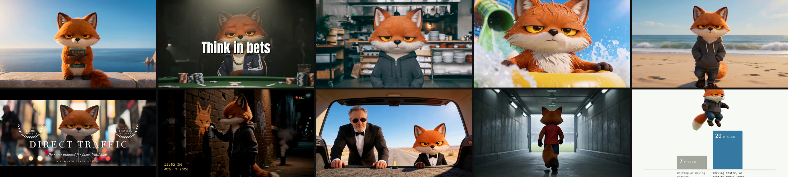

# Fox film skills for Claude

These are the film techniques we use to make short films with the Grumpy Fox, the Run with Foxes character. Each one
is a skill you can give Claude, so it can make the same kind of film with your own character: a Rounders freeze
frame, a Goodfellas walk, a Cannes trailer, a Tarantino trunk shot, footage from a stranger's phone.

I'm Paul Dervan. I run Run with Foxes, where we build AI agents for marketing teams, and I teach marketing at UCD.
We've made more films for the fox than for anyone else, and these are the ones that worked. Each skill is the method
as we use it, the words that keep a character the same from shot to shot, the scripts that cut and finish the film,
and the mistakes we made first so you don't have to.

## The skills

| Film | Skill and what it makes |
|---|---|
|  | **[film-basics](../skills/film-basics)** Start here. How to set up your own character so it holds across every clip, how to call the models, what it costs, and what the models get wrong. |
|  | **[hyperspeed](../skills/hyperspeed)** The camera flies fast through a whole place and lands on your character, who hasn't moved. |
|  | **[freeze-frame](../skills/freeze-frame)** The Rounders and Trainspotting intro: mid-action, a white flash, a freeze with a title, then the film carries on. |
| <a href="https://runwithfoxes.github.io/fox-film-skills/assets/films/one-take.mp4">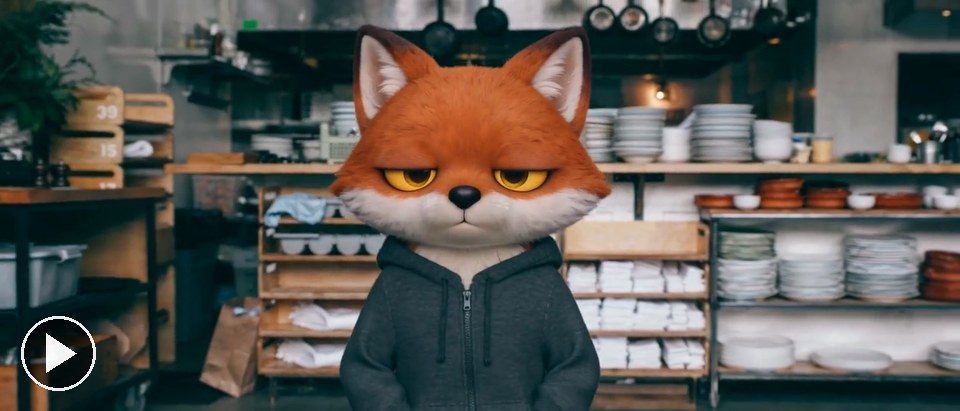</a> | **[one-take](../skills/one-take)** The Goodfellas walk: your character walks at a camera that backs away, and the place changes behind them with hard cuts. |
|  | **[waterslide](../skills/waterslide)** An action montage where your character does something fast and fun and never smiles. |
| <a href="https://runwithfoxes.github.io/fox-film-skills/assets/films/character-walk.mp4">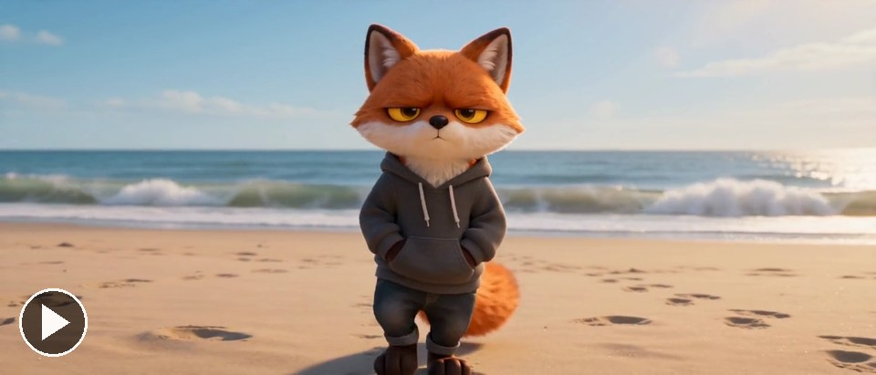</a> | **[character-walk](../skills/character-walk)** Your character walks, toward the camera or away down a tunnel, and only the place changes. |
| <a href="https://runwithfoxes.github.io/fox-film-skills/assets/films/festival-cut.mp4">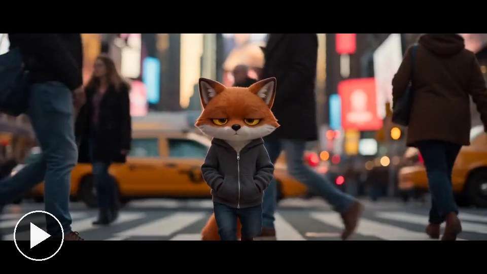</a> | **[festival-cut](../skills/festival-cut)** Documentary footage in a real place, dressed as a Cannes trailer: letterbox, laurels, a title the character walks into. |
| <a href="https://runwithfoxes.github.io/fox-film-skills/assets/films/phone-witness.mp4">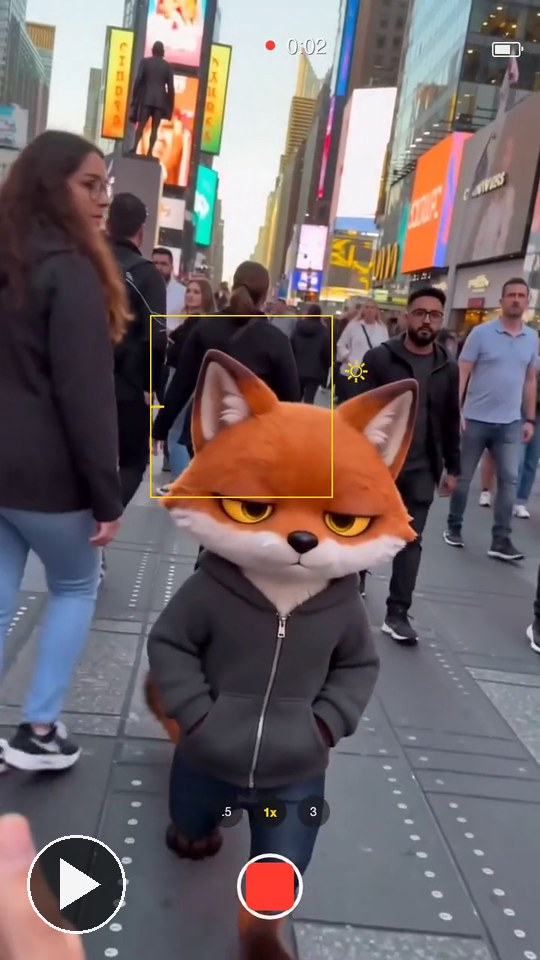</a> | **[phone-witness](../skills/phone-witness)** Your character caught on a stranger's phone, seen through the phone camera's own screen. Vertical. |
| <a href="https://runwithfoxes.github.io/fox-film-skills/assets/films/camcorder.mp4">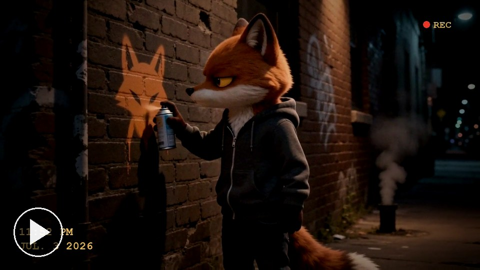</a> | **[camcorder](../skills/camcorder)** Night-time camcorder footage of your character spray-painting a wall, after Exit Through the Gift Shop. |
| <a href="https://runwithfoxes.github.io/fox-film-skills/assets/films/green-studio.mp4">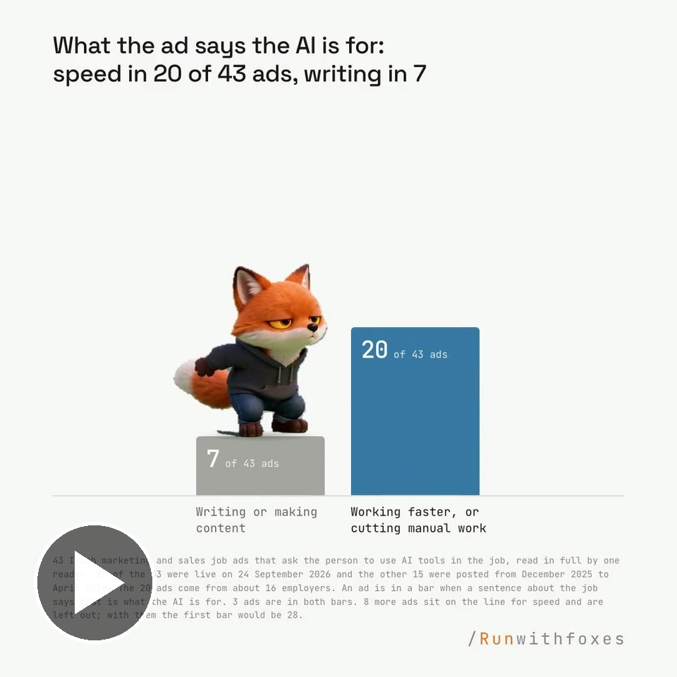</a> | **[green-studio](../skills/green-studio)** Your character acts on a green studio, gets cut out, and is laid on a chart drawn in code. |
|  | **[trunk-shot](../skills/trunk-shot)** Tarantino's shot from inside a car boot: it opens from black on your character looking down. |
| <a href="https://runwithfoxes.github.io/fox-film-skills/assets/films/real-world.mp4">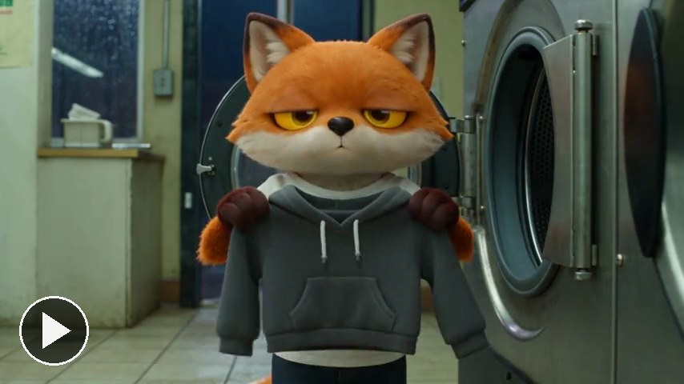</a> | **[real-world](../skills/real-world)** Your animated character in a real, photographic place, like a launderette at night, in one run of Seedance 2.5. |
|  | **[story-in-one-run](../skills/story-in-one-run)** A whole story with your character, up to 30 seconds, in one run of Seedance 2.5, so the face holds all the way. Ours is a wingsuit flight down a canyon. |
| <a href="https://runwithfoxes.github.io/fox-film-skills/assets/films/day-in-scenes.mp4">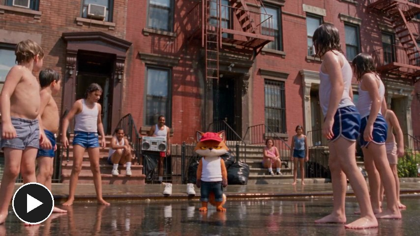</a> | **[day-in-scenes](../skills/day-in-scenes)** Three short films of your character joined into one day, with the time and the temperature on black between them, the way Do the Right Thing tracks the heat on one block. |
|  | **[stand-off](../skills/stand-off)** Sergio Leone's duel: your character and a real animal stare each other down over one small thing, in eye close-ups, until both move at once. |
| <a href="https://runwithfoxes.github.io/fox-film-skills/assets/films/still-shot.mp4">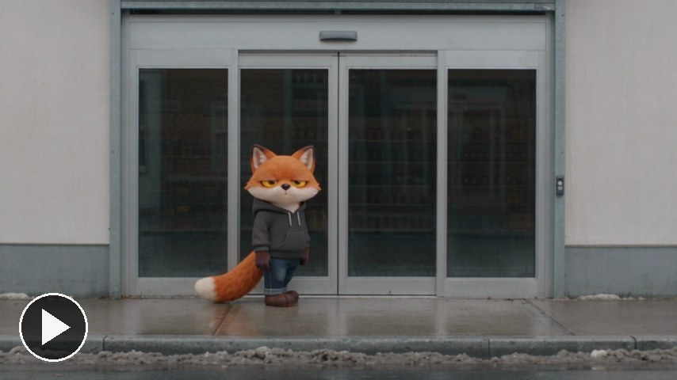</a> | **[still-shot](../skills/still-shot)** A one-joke comedy in one still shot, the Coen brothers' way: a plain camera, washed-out colour, and your character losing to something absurd. |
| <a href="https://runwithfoxes.github.io/fox-film-skills/assets/films/into-the-game.mp4">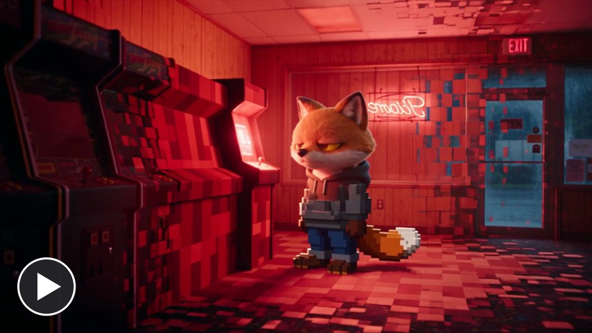</a> | **[into-the-game](../skills/into-the-game)** Your character goes from a real place into a video game: a realistic 1980s arcade breaks into blocks and they end up as a chunky pixel character. The game is drawn in code first, so the model has something exact to copy. |

Click a picture to play the film with sound. Every skill folder has a short README with the film, and a SKILL.md with the method.

## How to use them

In Claude Code, copy `film-basics` and the skill you want into `.claude/skills/` in your project, or into
`~/.claude/skills/` to have them everywhere. Then ask in plain words: "make a freeze frame of my character at a poker
table".

You need a Replicate account, with its key in your environment as `REPLICATE_API_TOKEN`, plus Python 3 and ffmpeg.
The trunk shot also uses fal.ai, with its key as `FAL_KEY`. Keys stay in the environment, never in a prompt or a file.

A test clip at 480p costs about 40 cents for 5 seconds on Replicate (prices checked September 2026, check before
you run). Most films need a few takes. Everything after the clip, the cutting, titles, overlays, shake and grain, is
free and runs on your own machine.

## A few things worth knowing

The fox isn't in here. His picture, his description and our prompts for him stay with us. The skills use "your
character" and show you how to make one, and that is the part most people skip. A character
that holds from shot to shot comes from one fixed description and one reference picture, used the same way every
time.

Look at every frame before anyone else does. Count the hands. The models are good and they still give a character a
third arm now and then.

## Credits

The films named here are the inspiration, and the credit belongs to the people who made them: Rounders, Danny
Boyle's Trainspotting and Guy Ritchie's films for the freeze frame; Martin Scorsese's Goodfellas, filmed by Michael
Ballhaus, for the walk; the Cannes Film Festival's trailers for the festival cut; Exit Through the Gift Shop, credited
to Banksy, for the camcorder; Quentin Tarantino's Reservoir Dogs and Pulp Fiction for the trunk shot; Sergio Leone's The Good, the Bad and the Ugly for the stand-off; Spike Lee's Do the Right Thing for the day in scenes; the Coen brothers' Fargo for the still shot; and the
Paddington films for how real fur on a designed character should look.

The films are made with Seedance 2 and Seedream 4.5 from ByteDance, run on Replicate, and the trunk shot's opening
with Kling from Kuaishou, run on fal.ai. The cutting is ffmpeg, the overlays are captured with Playwright, the titles
are drawn with Pillow and the keying uses OpenCV.

For the motion we draw in code (charts cut to a beat, handwriting on video, a label that follows a moving object),
see [motion-skills](https://github.com/runwithfoxes/motion-skills). For the marketing skills from my course, see
[marketing-skills](https://github.com/runwithfoxes/marketing-skills).

## Licence

The code and the written method are under the [MIT licence](LICENSE). The fox is not: the Grumpy Fox and every
picture and film of him in this repo belong to Run with Foxes. Make your own character.
