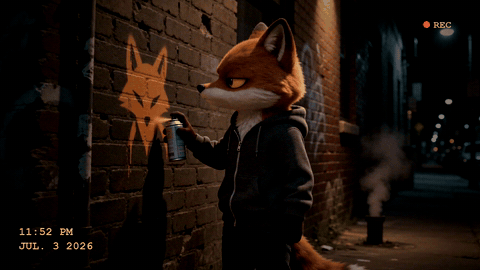

# Camcorder (Exit Through the Gift Shop)

The character filmed at night on an old camcorder, spray-painting their own logo on a wall, with one bored glance
back at the lens. [Watch it full size](../../assets/films/camcorder.mp4).

How to make it is in [SKILL.md](SKILL.md). `camcorder_ui.py` draws the date stamp and `build.sh` adds the shake,
grain and colour. Start with [film-basics](../film-basics) to set up your own character, and read the character lock
in SKILL.md first: this is the format where a character drifts most.

After Exit Through the Gift Shop, the street art documentary credited to Banksy. Made with Seedance 2 (ByteDance) on
Replicate. A 480p test clip costs about 40 cents.
