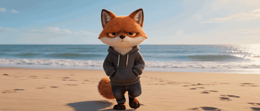
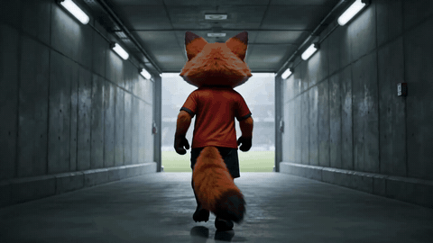

# Character walk

The character walks, toward the camera or away from it, and only the place changes.
[The beach](../../assets/films/character-walk.mp4) and [the tunnel](../../assets/films/character-walk-rear.mp4)
full size.

How to make it is in [SKILL.md](SKILL.md). The shot from behind needs a three-part lock, or the character comes back
as a real animal on four legs. Start with [film-basics](../film-basics) to set up your own character.

Made with Seedance 2 (ByteDance) on Replicate. A 480p test clip costs about 40 cents.
