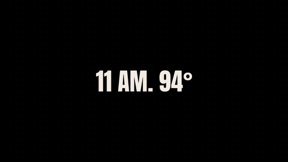

# A day in scenes

[Play the 58 second film, with sound](https://runwithfoxes.github.io/fox-film-skills/assets/films/day-in-scenes.mp4).

Three short films of your character joined into one day, with the time and the temperature on black between them,
the way Spike Lee's Do the Right Thing tracks the heat on one block. Each scene is one run of Seedance 2.5, and the
joining is a free script.

[SKILL.md](SKILL.md) has how to plan the scenes so they join, the cards, and what to watch for. `join_day.py` joins
the scenes and draws the cards. The three example prompts are the morning, afternoon and evening scenes of our film,
as they were run, with `../story-in-one-run/story_run.py`.

How we made it: runwithfoxes.com/craft/one-day-on-the-block, runwithfoxes.com/craft/the-fox-and-the-fire-hydrant and
runwithfoxes.com/craft/the-fox-and-the-ice-cream
