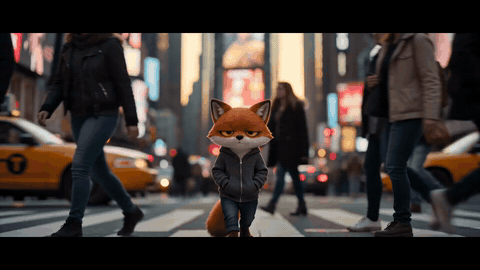

# Festival cut (Cannes)

The character filmed as documentary in a real place, then dressed as a festival trailer, so they walk into the
finished poster. [Watch it full size](../../assets/films/festival-cut.mp4).

How to make it is in [SKILL.md](SKILL.md). The laurels and title are web page templates here; `render_overlays.py`
captures them and `build.sh` puts the film together. Start with [film-basics](../film-basics) to set up your own
character.

Dressed after the Cannes Film Festival's trailers. Made with Seedance 2 (ByteDance) on Replicate, overlays captured
with Playwright, built with ffmpeg. A 480p test clip costs about 40 cents.
