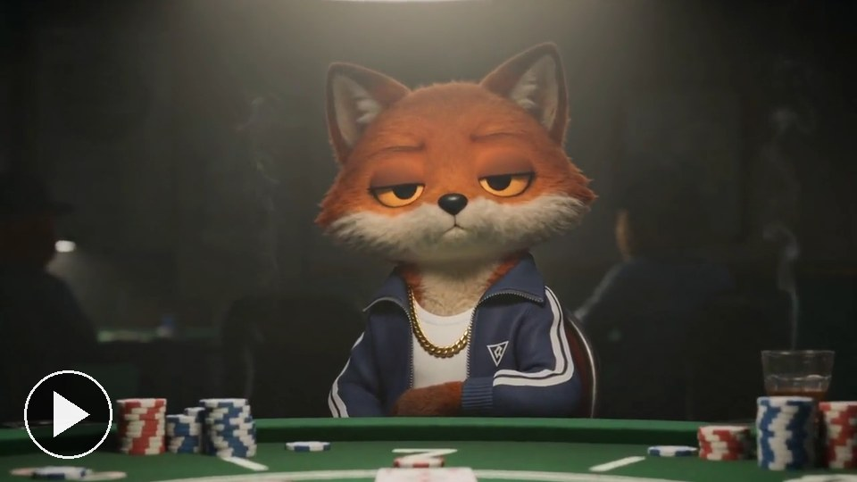
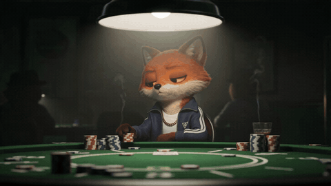

# Freeze frame (Rounders)

[Play the film](../../assets/films/freeze-frame.mp4).

The character is mid-action, the picture flashes white and freezes with a title for two seconds, then the film
carries on. [Watch it full size](../../assets/films/freeze-frame.mp4).

How to make it is in [SKILL.md](SKILL.md), and `freeze_frame.py` does the cutting. Start with
[film-basics](../film-basics) to set up your own character.

The device comes from Trainspotting and Guy Ritchie's films; we named ours after Rounders. Made with Seedance 2
(ByteDance) on Replicate, cut with ffmpeg. A 480p test clip costs about 40 cents.
