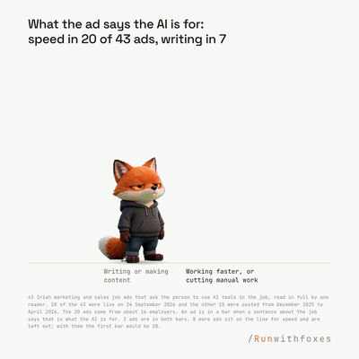

# Green studio

[Play the film](https://runwithfoxes.github.io/fox-film-skills/assets/films/green-studio.mp4).

The character acts on a flat green studio, gets cut out on every frame, and is laid on a chart drawn in code. The
body is one video clip; the chart, the numbers and the timing are code. [Watch it full size](https://runwithfoxes.github.io/fox-film-skills/assets/films/green-studio.mp4).

How to make it is in [SKILL.md](SKILL.md). `key.py` cuts the character off the green and `compose.py` lays them on
your film. Start with [film-basics](../film-basics) to set up your own character. To draw the chart itself in code,
see `motion-by-numbers` in our [motion-skills](https://github.com/runwithfoxes/motion-skills) repo.

Made with Seedance 2 (ByteDance) on Replicate, keyed with OpenCV. One 480p clip, 40 cents, was the whole of the fox
in this film.
