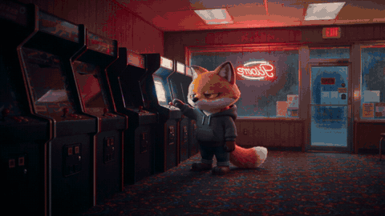

# From the real world into a video game

[Play the film, with sound](https://runwithfoxes.github.io/fox-film-skills/assets/films/into-the-game.mp4).

Your character starts in a real place, the world breaks into blocks around them, and they end up as a chunky pixel character in a video game. It is 12 seconds in one run of Seedance 2.5 and cost about $1.23. The game is drawn in code first, for nothing, so the model has something exact to copy.

[SKILL.md](SKILL.md) has the method, the prompt explained and what to check. `example-arcade-prompt.txt` is the full prompt for this film. `draw_level.py` and `sprite.py` draw the level and our fox, as a worked example. `story_run.py` runs a prompt with your reference pictures on Replicate, reading your key from `REPLICATE_API_TOKEN`.

How we made it: runwithfoxes.com/craft/the-fox-goes-into-the-game
