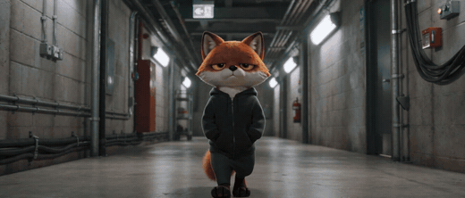

# One-take (Goodfellas)

[Play the film](https://runwithfoxes.github.io/fox-film-skills/assets/films/one-take.mp4).

The character walks at a camera that backs away in front of them, and the place changes behind them with hard
cuts. [Watch the whole film](https://runwithfoxes.github.io/fox-film-skills/assets/films/one-take.mp4): corridor, kitchen, stage.

How to make it is in [SKILL.md](SKILL.md), and `stitch.sh` joins the clips. Start with
[film-basics](../film-basics) to set up your own character.

After the Copacabana shot in Martin Scorsese's Goodfellas. Made with Seedance 2 (ByteDance) on Replicate. Each 480p
test clip costs about 40 cents, and a film needs three to five.
