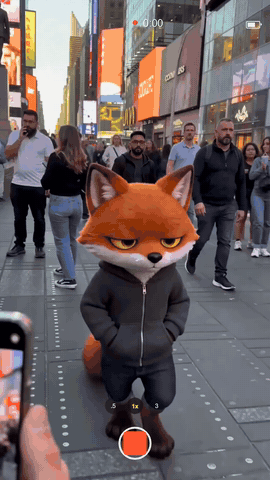

# Phone witness

The character caught on a stranger's phone, seen through the phone's own camera screen, with one bored glance at the
lens. Vertical, for Stories and Reels. [Watch it full size](../../assets/films/phone-witness.mp4).

How to make it is in [SKILL.md](SKILL.md). The phone screen is two web page templates here, `timer.py` draws the
counting timer, and `build.sh` adds the hand shake and puts it together. Start with [film-basics](../film-basics)
to set up your own character.

Made with Seedance 2 (ByteDance) on Replicate, built with ffmpeg. A 480p test clip costs about 40 cents.
