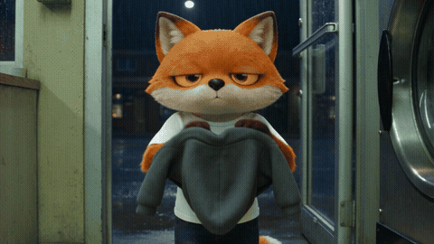

# The character in a real world

Your animated character in a real, photographic place, in one run of Seedance 2.5.
[Watch it with sound](../../assets/films/real-world.mp4).

[SKILL.md](SKILL.md) has the decisions, the two lines that make it look real, and what to watch for.
`example-launderette-prompt.txt` is the full prompt for this film. It runs with `../story-in-one-run/story_run.py`.

How we made it: runwithfoxes.com/craft/the-fox-in-a-real-launderette
