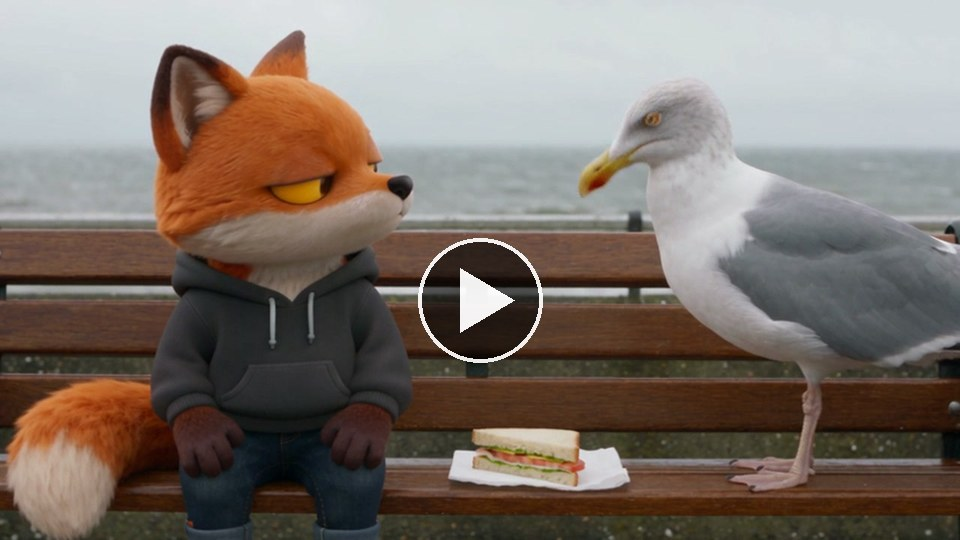
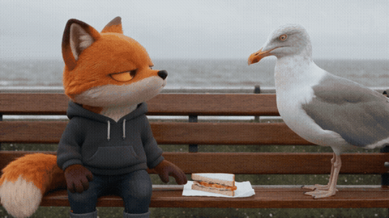

# The stand-off

[Play the 20 second film, with sound](https://runwithfoxes.github.io/fox-film-skills/assets/films/stand-off.mp4).

A stand-off between your character and a real animal over one small thing, shot the way Sergio Leone shoots a duel,
in one run of Seedance 2.5.

[SKILL.md](SKILL.md) has the decisions, the look before the close-ups, the music and what to watch for.
`example-seagull-prompt.txt` is the full prompt for this film. It runs with `../story-in-one-run/story_run.py`.

How we made it: runwithfoxes.com/craft/the-fox-and-the-seagull
