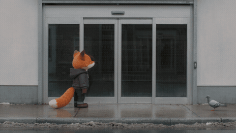

# The still shot

[Play the 15 second film, with sound](https://runwithfoxes.github.io/fox-film-skills/assets/films/still-shot.mp4).

A whole comedy in one still shot, the way the Coen brothers might shoot it: a plain camera that never moves, a long
shot, washed-out colour, and a deadpan character losing to something absurd. One run of Seedance 2.5.

[SKILL.md](SKILL.md) has why each line of the prompt is written the way it is. `example-door-prompt.txt` is the full
prompt for this film. It runs with `../story-in-one-run/story_run.py`.

How we made it: runwithfoxes.com/craft/the-door-that-wont-open
