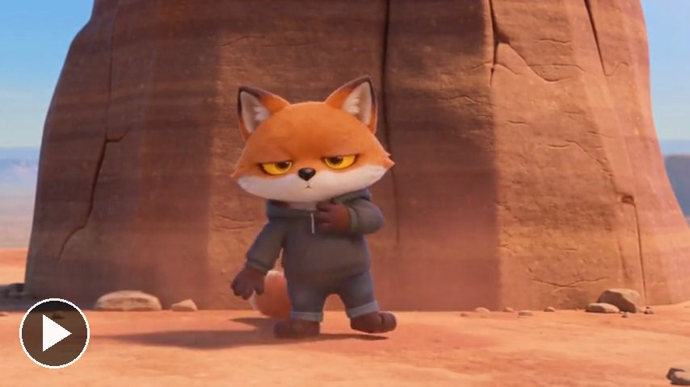
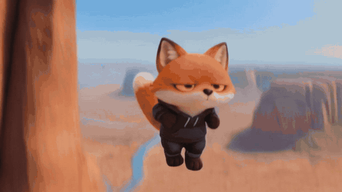

# A story in one run

[Play the film, with sound](../../assets/films/story-in-one-run.mp4).

A whole story with your character, up to 30 seconds, in one run of Seedance 2.5, so the face holds all the way.
[Watch it with sound](../../assets/films/story-in-one-run.mp4).

[SKILL.md](SKILL.md) has how to write the prompt as a shot list with seconds, the three things worth writing in, and
what to check. `example-canyon-prompt.txt` is the full prompt for this film, and `story_run.py` runs a prompt with
your reference pictures on Replicate, reading your key from `REPLICATE_API_TOKEN`.

How we made it: runwithfoxes.com/craft/a-30-second-film-in-one-run
