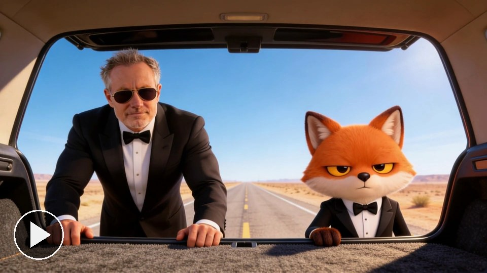

# Trunk shot (Tarantino)

[Play the film](https://runwithfoxes.github.io/fox-film-skills/assets/films/trunk-shot.mp4).

The camera is inside a car boot. It opens from black, and the character is standing there looking down, unimpressed.
Ours has Paul beside the fox. [Watch it full size](https://runwithfoxes.github.io/fox-film-skills/assets/films/trunk-shot.mp4).

How to make it is in [SKILL.md](SKILL.md): a still made first, a black frame made in code, and a model that animates
from one to the other. `black.py` and `kling_reveal.py` are here. Start with [film-basics](../film-basics) to set up
your own character.

After Quentin Tarantino's trunk shot in Reservoir Dogs and Pulp Fiction. Still made with Seedream 4.5 (ByteDance) on
Replicate; the opening with Kling (Kuaishou) on fal.ai.
