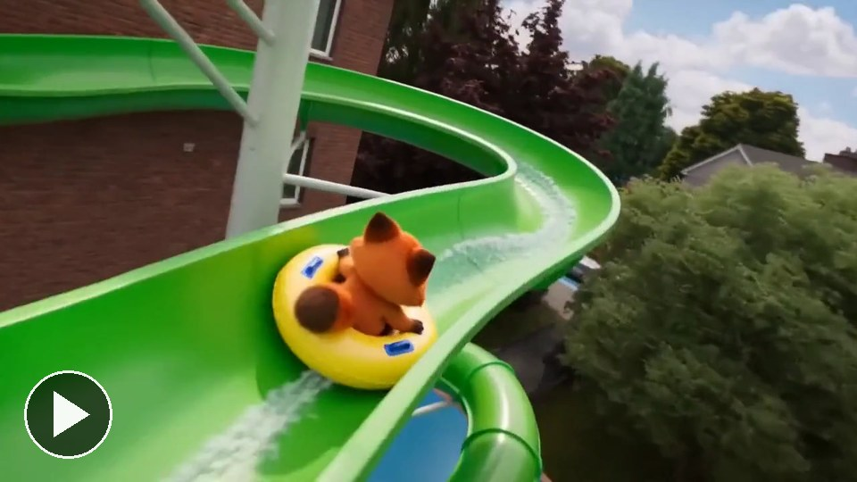
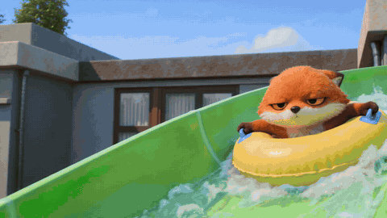

# Waterslide

[Play the film](https://runwithfoxes.github.io/fox-film-skills/assets/films/waterslide.mp4).

An action montage where the character does something fast and fun and never cracks a smile.
[Watch it full size](https://runwithfoxes.github.io/fox-film-skills/assets/films/waterslide.mp4).

How to make it is in [SKILL.md](SKILL.md). Start with [film-basics](../film-basics) to set up your own character.

The method uses Seedance 2 (ByteDance) on Replicate. Each 480p test clip costs about 40 cents, and a montage needs four
to six.
